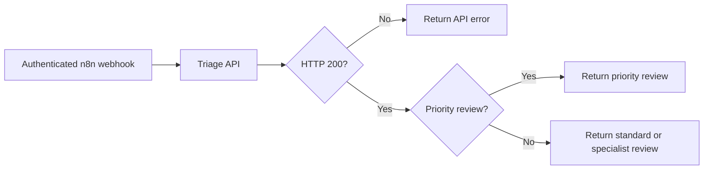

# CommerceFlow

An eCommerce support-ticket automation project built with **n8n, Node.js 24, SQLite and an optional OpenAI Responses API integration**. Created as an AI-assisted personal learning project.

A ticket becomes a validated classification, a draft reply and a human-review queue. All replies require human review. No customer messages are sent and no refunds are issued.

**Hosted API:** https://commerceflow-api-4i9p.onrender.com/  
**Health endpoint:** https://commerceflow-api-4i9p.onrender.com/health

The public root returns API information. Ticket submission requires a private API key. See [deployment details](docs/DEPLOYMENT.md) for access and n8n configuration.

## Workflow



The API validates tickets, prevents duplicate processing, runs classification, enforces review routing and saves results. n8n orchestrates webhook intake, API calls and response branches.

## Features

- Categories: shipping, refund, damaged item, product question and other.
- Priority: normal or high, with a local rule that raises safety-related requests to high priority.
- Structured LLM output with runtime validation.
- API-key authentication and a 16 KiB request-body limit.
- SQLite result caching, duplicate detection and ticket-ID conflict checks.
- Three total attempts for temporary OpenAI network, rate-limit and server failures.
- Explicit rules mode for offline use. Rules mode is not an LLM.
- Automated tests and GitHub Actions configuration.

## Run locally

Prerequisite: Node.js 24. There are no external npm dependencies.

```powershell
Copy-Item .env.example .env
node -e "console.log(require('crypto').randomBytes(32).toString('hex'))"
```

Put the generated value in `.env` as `TRIAGE_API_KEY`. Keep `AI_PROVIDER=rules` for offline use. Never commit `.env`.

```powershell
npm.cmd start
```

Open `http://localhost:3000/` for API information and `/health` for health status. This project is an API and workflow, with no demo interface.

### Submit a ticket

In another PowerShell window, set the same key locally:

```powershell
$env:TRIAGE_API_KEY = 'your-local-secret'
Invoke-RestMethod -Method Post -Uri http://localhost:3000/triage `
  -Headers @{ 'x-api-key' = $env:TRIAGE_API_KEY } `
  -ContentType application/json -Body (Get-Content examples/shipping.json -Raw)
```

The response includes `ticket_id`, `duplicate`, and a `result` containing category, priority, summary, draft reply, queue, provider and `status: awaiting_review`.

## n8n setup

With Docker Desktop installed:

```powershell
docker compose up -d --build
```

1. Visit `http://localhost:5678` and set up your local n8n account.
2. Import `workflows/commerceflow.json` using **Import from File**.
3. Create a **Header Auth** credential for **Ticket Webhook**. Choose a header name such as `x-webhook-key` and a separate random secret.
4. Create a second **Header Auth** credential for **Triage API**: name `x-api-key`, value equal to `TRIAGE_API_KEY` in `.env`.
5. Select those credentials in their respective nodes. Credentials are intentionally absent from the exported workflow.
6. In Compose, keep `http://triage:3000/triage`. For directly running local processes use `http://127.0.0.1:3000/triage`. For a hosted API use its HTTPS `/triage` URL.
7. Select **Listen for test event**, then POST one of the sample files to the displayed test URL with your webhook header.
8. Activate/publish the workflow and use the production URL for subsequent requests.

Authentication failures are handled by n8n before the API call. HTTP errors returned by the API take the error branch. Connection failures and timeouts fail the n8n execution; inspect that execution and retry after resolving the cause.

## OpenAI mode

Set the following in your private environment and restart the service:

```dotenv
AI_PROVIDER=openai
OPENAI_API_KEY=your-private-key
OPENAI_MODEL=gpt-4o-mini
```

This mode incurs API usage charges. It uses the Responses API with a strict JSON schema and `store: false`. Refusals, incomplete responses and invalid output return an error rather than silently switching to rules mode. Prompt instructions treat tickets as untrusted data and prohibit invented order status or promises of completed refunds.

Basic email and phone-like-number redaction runs before requests. This is not comprehensive PII removal. Original ticket text is not saved in SQLite, but generated summaries/drafts are saved and can contain sensitive information. Use synthetic tickets for this portfolio project.

## Free hosting

`render.yaml` provisions a **free Render web service for the API**, using the existing Dockerfile, rules mode and a generated API secret. It does not provision a hosted n8n instance.

After pushing the repository, create a Render Blueprint from the repository. The root URL returns API information. `/triage` stays authenticated; retrieve the generated `TRIAGE_API_KEY` privately from Render's environment settings and use it in the n8n HTTP credential.

Free Render services sleep after inactivity. Their local SQLite data is lost on sleep, restart or redeploy. Duplicate protection therefore lasts only as long as the current database exists. Local Docker volumes persist data across container restarts. Durable cloud storage requires a separate persistent-storage design.

## Project files and learning guide

See [docs/PROJECT_GUIDE.md](docs/PROJECT_GUIDE.md) for the purpose of every file, routing policy, error codes, design choices and interview talking points.

## Verification

```powershell
npm.cmd run check
npm.cmd test
```

The 14 tests cover ticket validation, classification, redaction, saved-result reuse, conflicts, concurrent duplicates, persistence across database reopening, provider retry behavior, simulated OpenAI output, HTTP handling and the workflow graph.

The OpenAI tests use simulated responses and make no paid requests. A workflow-graph test does not prove execution inside n8n. Live OpenAI and n8n execution require account configuration and separate verification. There are no Shopify, HubSpot, Slack or Google Workspace integrations in this version. Review queues are saved labels, not external task queues.

## References

- [n8n Webhook](https://docs.n8n.io/integrations/builtin/core-nodes/n8n-nodes-base.webhook/)
- [n8n HTTP Request](https://docs.n8n.io/integrations/builtin/core-nodes/n8n-nodes-base.httprequest/)
- [OpenAI Structured Outputs](https://developers.openai.com/api/docs/guides/structured-outputs)
- [Render free-service limitations](https://render.com/docs/free)
